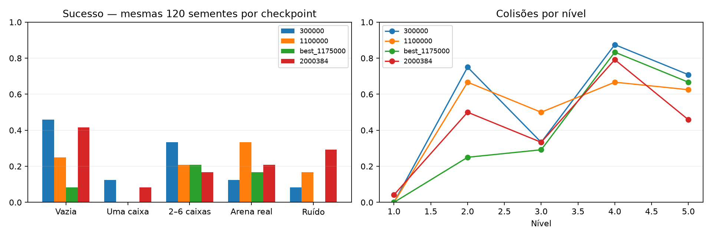
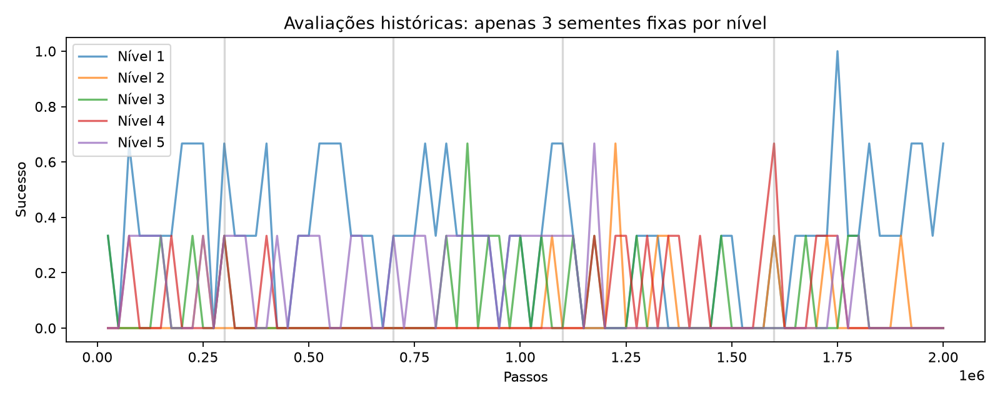
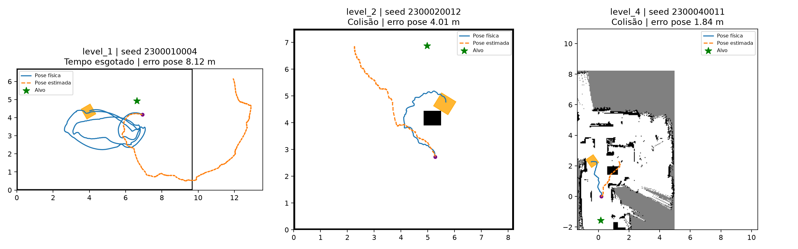

# Auditoria Robo-WORK RL v2 — 2.000.384 passos

## Conclusão

O aprendizado não mostrou evolução consistente. O checkpoint final consegue 28/120 sucessos (23,3%), contra 27/120 (22,5%) aos 300 mil passos. A diferença pareada de +0,8 ponto percentual é inconclusiva. Há oscilação e regressão em habilidades; não há evidência para justificar simplesmente prolongar o mesmo treino.

O visualizador foi reproduzido exatamente: 2/8 sucessos e 6/8 colisões. Ele usa nível 4 (mapa SLAM real mais caixas aleatórias), oito sementes fixas 2100000000–2100000007, política determinística e 1.500 ações por episódio. Não é a arena real sem caixas. Repetições substituem o resultado da mesma semente. O intervalo Wilson de 95% para 2/8 é 7,1%–59,1%: a amostra é pequena.

## Protocolo e preservação

Foram comparados quatro checkpoints em 120 cenários independentes cada: 24 por nível, sementes 2300000000 + nível×10000 + índice (0–23). Os hashes do mapa, pose inicial e objetivo coincidem entre todos os modelos para cada semente. São 480 episódios comparáveis mais 8 de reprodução do visualizador. Não houve aprendizado nesses processos; CPU, uma thread por processo, prioridade nice 15. Avaliação adicional de localização: 32 episódios; inspeção geométrica: 500 resets. Timeout original preservado: 1.500 ações × 0,16 s = 240 s.

Preservação por SHA-256: 1431 arquivos existentes verificados; alterações: []. Modelos, logs, código preexistente e mapa SLAM preservados. As adições posteriores da arena 2016 são arquivos novos. O status encontrado já dizia completed=true; nenhum controle do processo de treino foi executado.

## Resultados

| Checkpoint | Vazia | Uma caixa | 2–6 caixas | Arena real + caixas | Ruído | Total |
|---|---:|---:|---:|---:|---:|---:|
| 300000 | 11/24 | 3/24 | 8/24 | 3/24 | 2/24 | 27/120 |
| 1100000 | 6/24 | 0/24 | 5/24 | 8/24 | 4/24 | 23/120 |
| best_1175000 | 2/24 | 0/24 | 5/24 | 4/24 | 0/24 | 11/120 |
| 2000384 | 10/24 | 2/24 | 4/24 | 5/24 | 7/24 | 28/120 |

O total é uma média equilibrada dos cinco níveis; não estima a frequência de dificuldades de uma aplicação real. O checkpoint final tem IC95% de sucesso [16.7, 31.7]%. Na arena real são 5/24 sucessos e 19/24 colisões; na arena vazia são 10/24 sucessos, uma colisão e 13 timeouts.

Comparações pareadas com o final (bootstrap de 10.000 reamostragens e McNemar exato):

- versus 300000: Δ=0.8 pp; IC95% [-7.5, 9.2] pp; ganhos/perdas=13/12; p=1.000.
- versus 1100000: Δ=4.2 pp; IC95% [-2.5, 10.8] pp; ganhos/perdas=12/7; p=0.359.
- versus best_1175000: Δ=14.2 pp; IC95% [5.8, 22.5] pp; ganhos/perdas=24/7; p=0.003.

O best.zip histórico (1.175.000 passos) teve só 11/120 sucessos no conjunto novo. Ele foi escolhido por uma métrica de sucesso menos colisão em apenas três sementes por cenário. Melhor nesse pequeno conjunto não significa melhor generalização. Checkpoints de 300 mil, 1,1 milhão, melhor histórico e final foram amostrados; não foi feita avaliação ampla de todos os 201 checkpoints.

## Por que falha

1. **Currículo avança por relógio, sem domínio da etapa anterior.** As transições são 300k, 700k, 1,1M e 1,6M. Na fase de arena vazia, sucesso no treino foi 20,9%; na de uma caixa, 1,5%, com 54,0% de colisão. O treino seguiu para níveis mais difíceis assim mesmo. Esses números são exploratórios e não podem ser comparados diretamente entre fases; a comparação com sementes fixas acima controla essa diferença.
2. **Localização estimada deriva.** A observação usa alvo relativo a uma pose que integra comandos atrasados; a física inclui aceleração, atrito e escorregamento. Não há correção por LiDAR, encoders ou relocalização. O robô pode acreditar que chegou a outro local. A tabela de exemplos quantifica casos concretos.
3. **Desviar exige planejamento local e aceitar afastamento temporário.** A política MLP é reativa, sem memória nem mapa. O nível 2 põe uma caixa no segmento início–alvo. Progresso euclidiano penaliza o início de certos desvios; isso é hipótese de mecanismo, não prova causal isolada.
4. **Randomização de caixas não respeita objetos independentes válidos.** As posições são uniformes no retângulo do mapa, permitindo corte nas bordas, união com paredes e ocupação de desconhecido. A conectividade posterior evita muitos destinos impossíveis, mas não corrige esse desvio de domínio.

Experimento diagnóstico: substituir a pose estimada pela verdadeira antes de cada decisão, sem retreinar e nas mesmas 32 sementes de arena real (24 novas + 8 do viewer), resultou em 7/32 sucessos e 25/32 colisões, contra 7/32 e 25/32 do original. Houve 1 ganhos e 1 perdas individuais. Portanto, a deriva é real, mas corrigir apenas a pose nesse teste não resolveu a taxa agregada. Há também falhas de navegação/evitação. A entrada oracular muda a distribuição aprendida: esse teste não equivale a um sistema de localização validado.

## Colisões, alcançabilidade e footprint

A colisão usa SAT do polígono completo: x=[−0,205;0,365] m e y=[−0,315;0,315] m (0,57×0,63 m; circunraio ≈0,482 m). Há quatro subpassos de 40 ms e margem conservadora de volume varrido; a penalidade pode ocorrer antes do contato geométrico exato, o que é intencionalmente conservador. A margem de footprint de 1 cm do Nav2 não é explicitamente somada ao polígono. O sensor fica em [0,33;0,005] m.

Na classificação aproximada das 51 colisões do checkpoint final no conjunto de 120, o obstáculo mais próximo do último footprint registrado era caixa adicionada em 29 casos e parede do mapa base em 22. Em 27 casos, a direção do centro dessa célula a partir do LiDAR caiu em um setor mascarado. Isso sugere examinar cobertura lateral/traseira e comportamento em quinas. A análise usa proximidade no estado anterior à última ação, não contato instrumentado nem prova de invisibilidade: feixes vizinhos podem enxergar o obstáculo. Detalhes em `collision_analysis.json`. A correspondência dos setores com o filtro real (`invert_angles`) e os extrínsecos ainda necessita calibração.

A conectividade usa células com clearance conservador >0,52 m, quatro conexões, após inserir caixas. Isso fornece uma rota translacional para um disco que contém o footprint em qualquer orientação. É suficiente, porém conservador: elimina passagens que o robô retangular poderia atravessar orientado. Nos 500 resets (100/nível), zero colisões iniciais e zero objetivos em colisão nas 16 orientações inspecionadas. Isso sustenta que os objetivos amostrados são geometricamente alcançáveis no simulador; não valida acessibilidade física da arena real nem o tempo de navegação por desvio.

Caixas nos cenários **aceitos** da inspeção (a contagem também registra caixas totalmente escondidas em obstáculos):

| Nível | Tentativas em cenários aceitos | Cortadas | Sobrepostas a bloqueado | Tocando desconhecido |
|---|---:|---:|---:|---:|
| 2 | 100 | 0 | 0 | 0 |
| 3 | 360 | 69 | 95 | 0 |
| 4 | 381 | 46 | 339 | 280 |
| 5 | 655 | 45 | 120 | 0 |

## Recompensas e horizonte

Chegada verdadeira a menos de 0,20 m sem colisão: +100. Colisão: −100. Progresso verdadeiro: 15×redução de distância. Custos por ação: 0,015 de tempo; até 0,025 por proximidade; 0,01×deslocamento; 0,03×rotação; 0,01 por inversão; 0,025 por estagnação; 0,02 se deslocamento <1 mm. Não recompensa progresso fictício de odometria. O Nav2 copiado usa tolerância xy de 0,06 m e yaw de 0,17 rad, diferentes do sucesso de navegação simplificado aqui. Não exige parar ao chegar nem orientação final; pode premiar passar pelo raio do alvo.

PPO usa gamma=0,995: horizonte nominal ≈200 ações=32 s, meia-vida ≈138 ações=22 s. Um percurso ideal de 7 m a 0,20 m/s já dura 35 s (≈219 ações), antes de desviar, acelerar ou corrigir heading. O +100 terminal fica com peso ≈33,4 após 219 ações. Progresso euclidiano não é potential-based shaping com o gamma usado: não há garantia de preservar a política ótima. Os incentivos favorecem chegada segura no desenho geral, mas não eliminam mínimos locais nem alinham percepção e recompensa. Não foi realizado ablation de recompensa/novo treino; recomendações são para teste controlado.

## Velocidades e acelerações

O vx=0,186 m/s da tela é `decision_velocity()` — comando solicitado, não velocidade física ou medida. É 93% do limite vx=0,20 m/s. Limites usados: vy=0,08 m/s, wz=0,16 rad/s, ré=0,16 m/s, norma xy≤0,20 m/s; aceleração [0,2;0,2;0,4], desaceleração [0,5;0,5;0,2]. Os valores coincidem com FollowPath da configuração real copiada. Smoother real permite vy=0,16, wz=0,40, aceleração angular=0,8 e desaceleração angular=1,2: o simulador usa os limites do controlador, não reproduz integralmente a cadeia real.

No nível 5, ganho de atrito pode chegar a 1,1 e ruído físico é somado depois do limitador, permitindo velocidade física acima do comando. Não há saturação final nem limite físico rigoroso de aceleração após ruído. A seleção original entre acelerar/frear olha apenas magnitudes e aplica desaceleração ao inverter sinais até ultrapassar zero. Exemplo controlado de vx inicial −0,01 m/s e alvo +0,20: o primeiro tick de 40 ms pode mudar +0,02 m/s (0,5 m/s²), usando a frenagem também para acelerar após cruzar zero.

O hardware (`coleta_base/robo_hardware/src/hardware_bridge_node.cpp`) mistura rodas com k=(0,34+0,615)/2, satura a roda máxima em 0,45 m/s e converte para PWM mínimo 150 (80 em rotação), máximo 215; inclui heading hold. Nada disso está calibrado no modelo simplificado. Configuração nominal não é comprovação de velocidade/aceleração real: medir trajetórias e frenagem por localização externa/IMU antes de qualquer sim-to-real. Nenhum ensaio no robô foi executado.

## Exemplos reproduzíveis

Linhas azuis: pose física; tracejadas: pose estimada; estrela: alvo; laranja: footprint no último estado registrado. Cada NPZ contém ações, trajetória física/estimada, velocidades internas, ocupação e alvo. O último registro é anterior à última ação; não é o ponto exato do contato.

- level_1, seed 2300010004: timeout, 240.0 s; alvo físico a 2.68 m; erro de pose 8.12 m; alvo estimado a 5.44 m.
- level_2, seed 2300020012: colisão, 73.4 s; alvo físico a 2.21 m; erro de pose 4.01 m; alvo estimado a 2.73 m.
- level_4, seed 2300040011: colisão, 39.4 s; alvo físico a 3.87 m; erro de pose 1.84 m; alvo estimado a 4.03 m.

## Candidata e próximos passos

A pasta `candidata/` contém cópia separada com duas correções locais: rejeitar caixa cortada/sobreposta e separar frenagem de aceleração na reversão. Testes de contratos e 50 resets passaram (`candidate_tests.json`). Não foi ativada, treinada nem demonstrou melhora de sucesso. A colocação rejeitada ainda pode reduzir a quantidade de caixas; o README registra que precisa reamostragem explícita.

Recomendações em ordem:

1. Manter o treino atual preservado e usar a arena limpa/uma caixa como gates. Progredir só após meta pré-definida de sucesso e colisão em sementes de validação, com conjunto de teste separado.
2. Consertar e instrumentar a geração: número efetivo de caixas, não sobreposição, regiões permitidas, footprint e conectividade. Avaliar arena real sem caixas como controle adicional; o nível 4 original mistura ambos.
3. Comparar localização perfeita (diagnóstico), dead reckoning e localização corrigida por sensores em treinos independentes. Medir erro de pose e colisão por causa, evitando atribuir tudo à deriva.
4. Testar shaping por distância geodésica segura/potencial com gamma correto, horizonte adequado e critério de chegada com velocidade baixa. Fazer ablations com o mesmo orçamento e sementes, em vez de trocar vários componentes de uma vez.
5. Calibrar física por dados reais: relação comando/PWM/velocidade, atraso, aceleração, frenagem, escorregamento, footprint com padding e extrínsecos/máscara LiDAR.
6. Selecionar checkpoint por validação ampla e guardar teste independente. Reavaliar checkpoints após treino, pois salvamentos periódicos ocorrem dentro de rollouts antes da próxima atualização; número de passos não implica número igual de atualizações úteis.

Artefatos: `summary.json`, `history.json`, `geometry.json`, `failure_examples.json`, `episodes_*.json`, trajetórias `*.npz`, scripts reproduzíveis e hashes de preservação. Não há evidência suficiente de ganho entre 300k e 2M para continuar o mesmo experimento sem revisão.
