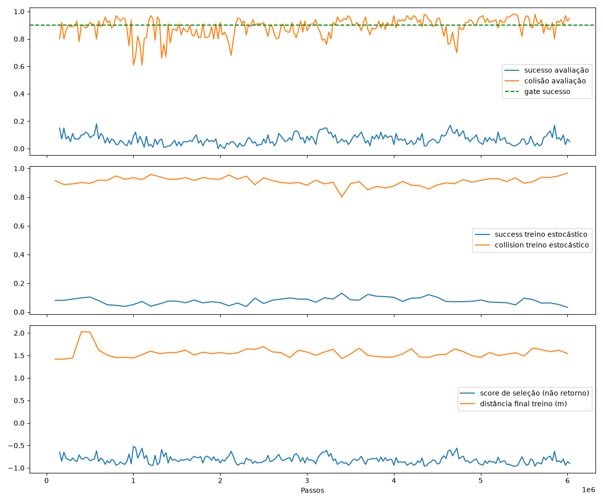
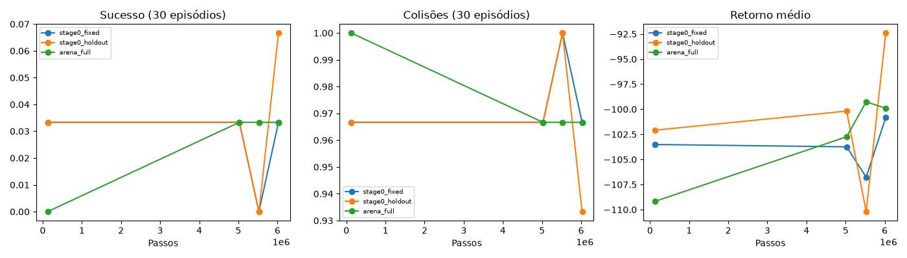
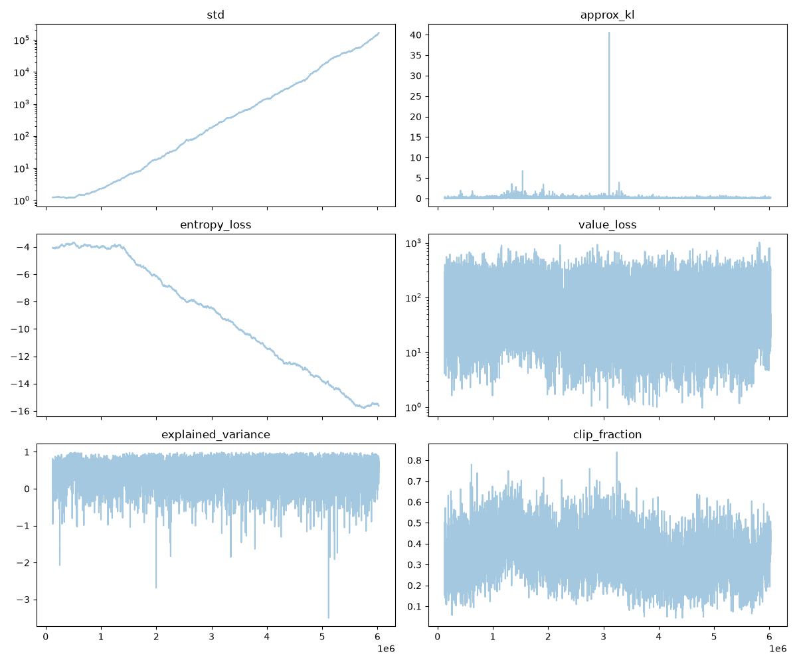

# Diagnóstico quantitativo do treinamento — 11/11/2026

Recorte congelado: **6,025,000 passos**, checkpoint `ppo_000006025000.zip`. A execução continuou avançando durante a auditoria. Nenhum `learn`, `save`, alteração de pesos, sinal ou pedido de parada foi dirigido à execução original. Somente os scripts e resultados desta pasta foram criados. Os checkpoints foram carregados para inferência em CPU, em instâncias independentes.

Foram analisadas **236 avaliações históricas** e **23,077 episódios de treino**. Foram reavaliados quatro checkpoints, com 30 sementes por checkpoint e por distribuição: **360 episódios novos**, determinísticos. Os resultados e hashes estão nos CSVs e JSONs anexos.

## Conclusão

O PPO está executando atualizações numéricas, mas não há evidência de melhora sustentada recente na tarefa. A exploração angular degenerou: o desvio padrão da ação de rotação atingiu aproximadamente **506.503**, enquanto os de translação são aproximadamente **0,325 e 0,519**. A recompensa de entropia é calculada sobre a Gaussiana antes do recorte das ações e permanece ativa (`ent_coef=0.01`). Isso oferece um incentivo ilimitado a aumentar a variância de uma variável cuja ação física já está saturada. É uma falha de configuração fortemente sustentada pelos dados; a causalidade da recuperação precisa ser testada na execução controlada proposta.

## 1. Currículo e contador de estagnação

`train_gated.py:15, 75–82` define quatro estágios: (0) distância entre 0,8 e 2 m, trajetória direta livre; (1) até 2 m sem exigir trajetória direta; (2) até 4 m; (3) até 12 m. A promoção exige simultaneamente sucesso ≥90% e **zero colisões nos mesmos 100 episódios**. Não há promoção por quantidade de passos. Nenhuma avaliação histórica passou pelo gate.

`stale_evaluations` conta avaliações consecutivas cujo **score = fração de sucessos − fração de colisões** não superou o melhor score em mais de 0,005. Não conta episódios, rollouts ou atualizações sem gradiente. O melhor score, **−0,52**, foi registrado em **1.000.000 passos**: 9 sucessos, 61 colisões e 30 timeouts. É um score de seleção, não recompensa média.

No estado informado pelo usuário: `(5.950.000 − 1.000.000) / 25.000 = 198`. Isso explica exatamente o contador. `early_stop=false` permite que a execução prossiga apesar da estagnação; `patience=4` só atua com `--early-stop`. Diferenças entre `live.json`, último checkpoint e última avaliação são esperadas: são gravados em cadências distintas.

A exigência de zero colisões é estatisticamente exigente: mesmo uma política com risco real de colisão de 1% teria apenas 36,6% de probabilidade de registrar zero em 100 episódios; para risco de 2%, a probabilidade seria 13,3%. Entretanto, com mais de 90% de colisões, afrouxar esse gate não resolve a falha atual. Zero em 100 tampouco prova risco zero: o limite superior unilateral de 95% é aproximadamente 2,95%.

Há outro problema de persistência a corrigir em uma cópia: o supervisor mantém um único `supervision.json`, com o estado mais recente. Retomar um checkpoint histórico pelo mesmo script pode falhar por `state.steps != model.num_timesteps`. O experimento deve carregar pesos e Adam do checkpoint escolhido e inicializar explicitamente um supervisor novo de estágio 0, salvando estado por checkpoint. Não editar o supervisor original.

## 2. Tendências nos últimos 500 mil e 1 milhão de passos

Cada janela recente é comparada com a janela imediatamente anterior de igual tamanho. As avaliações reutilizam as mesmas 100 sementes; portanto, elas não constituem milhares de cenários independentes. Os intervalos abaixo usam bootstrap pareado por cenário e não medem variabilidade entre sementes de treinamento.

| Janela | Sucesso anterior → recente | Colisão anterior → recente |
|---|---:|---:|
| 500k | 5.50% → 7.05% | 93.40% → 91.15% |
| 1M | 7.38% → 6.28% | 90.62% → 92.27% |

No treino estocástico, o quadro é pior: nas janelas de 500 mil, sucesso cai de 7,10% para 6,34% e colisões sobem de 92,01% para 93,49%; nas de 1 milhão, sucesso cai de 8,53% para 6,65% e colisões sobem de 89,58% para 92,89%. Isso reforça que a pequena recuperação da avaliação determinística recente não representa melhora geral da coleta.

Os recortes terminam na avaliação de 6.025.000: para 500 mil, (5.025.000; 5.525.000] versus (5.525.000; 6.025.000]; para 1 milhão, (4.025.000; 5.025.000] versus (5.025.000; 6.025.000].

Em 500 mil, a variação de sucesso é **+1,55 ponto percentual**, IC95% por cenário **[−0,45; +3,70]**: recuperação pequena sem evidência clara de melhora de sucesso. As colisões caem 2,25 pontos, IC95% [−4,40; −0,15]. Em 1 milhão, o sucesso cai **1,10 ponto**, IC95% [−3,05; +0,875], e colisões aumentam 1,65 ponto, IC95% [−0,375; +3,65]. O conjunto indica um platô ruim com oscilações, sem melhora sustentada.

**Limitação de instrumentação:** os logs históricos não armazenam retorno por episódio. `episodes.csv` grava sucesso, colisão, tempo e distância; os JSONs de avaliação também omitem recompensa. Não é possível recuperar honestamente a recompensa média histórica de cada janela. A tabela a seguir mede novamente o retorno de checkpoints nas mesmas sementes; ela não deve ser confundida com retorno do treino estocástico ao longo dessas janelas.

## 3. Comparação independente de checkpoints

`stage0_fixed`: primeiras 30 sementes do gate; `stage0_holdout`: 30 sementes novas, mesma distribuição de estágio 0; `arena_full`: 30 sementes novas na distribuição padrão da Arena 2016 v2, até 12 m. Cada distribuição usa cenários idênticos entre checkpoints. O LiDAR nativo acelera a avaliação e foi validado contra a implementação Python.

| Passos | Distribuição | Sucesso | Colisão | Retorno médio | DP do retorno | Distância final (m) |
|---:|---|---:|---:|---:|---:|---:|
| 125,000 | stage0_fixed | 3.3% | 96.7% | -103.51 | 42.08 | 1.51 |
| 125,000 | stage0_holdout | 3.3% | 96.7% | -102.09 | 40.71 | 1.53 |
| 125,000 | arena_full | 0.0% | 100.0% | -109.18 | 7.29 | 2.97 |
| 5,025,000 | stage0_fixed | 3.3% | 96.7% | -103.74 | 41.71 | 1.50 |
| 5,025,000 | stage0_holdout | 3.3% | 96.7% | -100.18 | 41.67 | 1.37 |
| 5,025,000 | arena_full | 3.3% | 96.7% | -102.74 | 41.40 | 2.84 |
| 5,525,000 | stage0_fixed | 0.0% | 100.0% | -106.77 | 6.78 | 1.42 |
| 5,525,000 | stage0_holdout | 0.0% | 100.0% | -110.20 | 14.63 | 1.64 |
| 5,525,000 | arena_full | 3.3% | 96.7% | -99.26 | 38.53 | 2.74 |
| 6,025,000 | stage0_fixed | 3.3% | 96.7% | -100.83 | 40.63 | 1.57 |
| 6,025,000 | stage0_holdout | 6.7% | 93.3% | -92.40 | 55.98 | 1.44 |
| 6,025,000 | arena_full | 3.3% | 96.7% | -99.90 | 40.76 | 2.90 |

No holdout do estágio 0, o retorno médio recuperou de −110,20 (5,525 milhões) para −92,40 (6,025 milhões), diferença +17,80, IC95% pareado por cenário [+1,72; +38,91]. Isso é uma melhora localizada nessa amostra; na arena completa, o retorno passou de −99,26 para −99,90 e o sucesso continuou em 1/30. Contra 5,025 milhões, o ganho de retorno do holdout é +7,78, IC95% [−15,17; +31,38]. Não há melhora consistente nas duas escalas e distribuições. Os intervalos são exploratórios, sem ajuste para múltiplas comparações.

A amostra de 30 episódios por condição tem incerteza considerável. Diferenças pareadas e ICs por cenário estão em `statistics.json`; não foram executadas réplicas de treinamento. O checkpoint inicial de 125 mil já herdou treinamento anterior: ele não é uma política aleatória. O offset histórico declarado no config é 2.347.094 passos; o contador visível não representa toda a história de otimização.

## 4. PPO: atualização real e exploração degenerada

| Métrica (mediana) | Milhão anterior | Milhão recente |
|---|---:|---:|
| std | 4339.7 | 44387 |
| approx_kl | 0.045762 | 0.055295 |
| entropy_loss | -12.59 | -15.242 |
| policy_gradient_loss | -0.030062 | -0.031222 |
| value_loss | 43.507 | 40.136 |
| explained_variance | 0.43183 | 0.47873 |
| clip_fraction | 0.26953 | 0.29805 |

A taxa de aprendizado é 3e−4, `clip_range=0.2`, 10 épocas por rollout de 512 transições (2 ambientes × 256 passos), minibatches de 64, `gamma=0.995`, e `target_kl=None`. A fração recortada perto de 30% e KL mediana perto de 0,055 mostram atualizações expressivas; não existe parada de épocas por KL. O clipping do PPO limita parte do objetivo, não impõe um teto ao KL observado.

| Checkpoint | n_updates | Desvio padrão por eixo (x, y, rotação) | RMS da mudança dos demais parâmetros desde 125 mil |
|---:|---:|---|---:|
| 125,000 | 48280 | 0.473, 0.6912, 2.533 | 0.00000 |
| 5,025,000 | 143980 | 0.433, 0.6513, 5.144e+04 | 0.28190 |
| 5,525,000 | 153740 | 0.5775, 0.7492, 1.364e+05 | 0.29510 |
| 6,025,000 | 163510 | 0.3251, 0.5194, 5.065e+05 | 0.31104 |

`n_updates` no SB3 contabiliza épocas de otimização, não o número literal de chamadas ao Adam. Os pesos do ator e crítico mudaram, o contador avançou e o KL é não nulo: isso demonstra otimização real. `explained_variance` perto de 0,48 indica alguma capacidade do crítico de explicar seus alvos; não demonstra navegação bem-sucedida. As losses são ruidosas e não provam melhora comportamental.

Em 100 observações iniciais de cenários novos, a probabilidade média calculada de recorte da ação estocástica foi **85,92% em x, 47,93% em y e 99,999842% em rotação**. Mesmo na inferência determinística, a média bruta ultrapassou os limites em **87%, 46% e 93%** das observações, respectivamente. Esses números descrevem o probe de estados iniciais; não são frequências medidas durante todo o histórico.

A Gaussiana angular quase sempre vira −1 ou +1 no ambiente, e mudanças da sua média têm influência mínima sobre a exploração quando o desvio é tão grande. A entropia contínua antes do recorte continua crescendo, mesmo sem ganho útil na diversidade de ações físicas. Há uma divergência relevante entre coleta estocástica e avaliação determinística. Entropia alta, neste caso, não é evidência de exploração produtiva.

## 5. Recompensa e objetivo

`robo_rl_v2/env.py:197–205` usa verdade física para recompensa: `15 * (distância_anterior − distância_atual) − 0,015`, mais penalidades por proximidade, deslocamento, rotação, reversões de comando, imobilidade e ficar preso; sucesso acrescenta 100, colisão subtrai 100. Sucesso exige apenas distância ao objetivo menor que 0,2 m e ausência de colisão.

Para navegação curta em linha livre, o sinal principal está alinhado: aproximar dá recompensa, chegar é muito melhor que colidir e rodar sem necessidade custa. A parcela de progresso sem desconto telescopa em `15 * (distância_inicial − distância_final)`: oscilar para longe e voltar não produz ganho líquido dessa parcela. Não há evidência de recompensa positiva artificial por odometria, porque o progresso usa pose física.

Há limitações: (a) a penalidade de proximidade usa distância do centro menos raio circunscrito, conservadora para um footprint retangular; (b) distância euclidiana pode punir desvios necessários nos próximos estágios; (c) a localização observada integra comandos atrasados com bias, sem correção pelo LiDAR, enquanto o movimento físico inclui atrito/slip — a estimativa pode divergir da verdade que gera a recompensa; (d) a recompensa não exige orientação final, parada nem docking. Embora `goal_pose` seja amostrado, seu yaw não entra no objetivo nem na observação. Se o objetivo desejado inclui encosto em bancada, a tarefa atual está incompleta.

O bônus de entropia pertence à loss do PPO e não ao retorno do ambiente. É a principal falha identificada na combinação objetivo/distribuição de ações. Não há demonstração de que mudar os pesos de recompensa do ambiente, sozinho, resolveria a estagnação.

## 6. Diversidade dos cenários

O sampler contém 1,163,258 estados admissíveis e 24 orientações discretas. No probe de 100 sementes novas, houve **100 poses iniciais diferentes**, com distâncias entre **0,814 e 1,975 m**. Há variação de posições, destinos, headings, atrito (0,9–1,0), bias e ruído. Os dois ambientes de treino recebem sementes distintas via SB3. Não é repetição literal do mesmo episódio.

A diversidade permanece limitada: mapa e móveis fixos, slip 0,03, atraso de um tick, ruído sensorial baixo, somente trajetórias diretas e curtas enquanto no estágio 0. O sampler é condicionado pela folga >0,52 m ao longo do segmento. Não há randomização de layouts, caixas ou obstáculos dinâmicos nesse treino. A avaliação do gate repete deliberadamente as mesmas 100 sementes; o visualizador padrão repete 8 cenários. Não confundir repetição de avaliação com repetição dos episódios de treinamento.

## 7. Compatibilidade com a Arena 2016 v2

| Item | Resultado |
|---|---|
| Observações | Mesmo vetor de 152: 72 raios, 72 máscaras, objetivo local estimado, comando anterior e taxa odométrica estimada; mesma normalização |
| Ações | Mesmo Box [-1,1]³, velocidades relativas ao robô, recorte e limites físicos iguais |
| Mapas e objetos | Grids físicos e de LiDAR exatamente iguais; lista de objetos do layout também igual |
| Dinâmica | Mesmo `RoboEnv.step`, dt=0,16 s, 4 subticks; mesmos footprint, acelerações, atrito/slip e ruídos do nível 4 |
| Velocidades máximas | x=0,20 m/s, y=0,08 m/s, yaw=0,16 rad/s; ré=0,16 m/s |
| Recompensa e término | Mesma função, sucesso <0,2 m, colisão terminal, limite 1.500 passos (240 s) |
| Distribuição dos episódios | Treino em estágio 0: 0,8–2 m e linha livre; Arena padrão: 0,8–12 m e possíveis desvios |

Nos testes de paridade, o LiDAR nativo e o Python produziram **erro máximo zero** em observações, recompensa e pose nas trajetórias testadas (10 cenários, até 20 ações cada, interrompidas ao término). Também foram comparados os resets de 10 sementes da arena completa: pose, objetivo e observação idênticos. Isso valida a equivalência nos casos testados; não constitui prova formal para todos os estados.

O YAML do treino difere do layout de revisão em metadados de áreas de serviço. Entretanto, `Arena2016V2Env` carrega as duas grids de `assets/arenas/arena_2016_v2/review/` por caminho fixo: o parâmetro `layout` não seleciona novas grids. Os hashes do YAML sozinhos não garantem reprodução da geometria efetivamente carregada. Versionar também grids, configurações físicas, sampler e biblioteca nativa numa nova execução.

O visualizador `viewer2016v2.py` tem dois detalhes relevantes: por padrão aponta para `runs/treino_2016_transferido_20261110_085342`, não para o treino contínuo analisado; é necessário fornecer `--run` correto. Sua mensagem fixa de que o checkpoint veio da arena anterior não consulta o config e é enganosa para este treino nativo v2. Não foi possível confirmar os argumentos de um visualizador em execução pelo namespace de processos disponível; esta constatação refere-se ao código e aos padrões de lançamento.

## 8. Correções e experimento controlado proposto

O plano de parâmetros está em `experimento_proposto.json`; **não foi iniciado outro treinamento**. Criar cópia versionada dos fontes e diretórios exclusivos por braço/semente. Carregar o checkpoint de 125 mil preservado, mantendo as condições iniciais comuns e restaurando Adam; inicializar um supervisor novo de estágio 0. Nenhuma escrita deve ocorrer dentro da execução atual.

Primeiro experimento: fatorial 2×2 com bônus de entropia {0,01; 0} e projeção de `log_std` {ausente; [−3,0]}, três sementes de treino por braço. O limite deve ser aplicado antes do primeiro rollout e após cada passo do otimizador na cópia do algoritmo, não somente uma vez por rollout. Registrar a frequência de projeção e comportamento dos momentos do Adam. Essa projeção é uma intervenção a validar, não uma garantia de estabilidade.

Manter recompensa, mapas, física, distribuição de cenários, learning rate, KL e currículo constantes para isolar as duas intervenções. Usar 500 mil passos adicionais por réplica no piloto, estendendo os vencedores a 1 milhão. Executar no máximo um treinamento experimental por vez, com baixa prioridade, evitando disputar recursos com a execução atual.

Avaliar a cada 25 mil passos com os mesmos cenários fixos e um holdout distinto; separar ainda 300 cenários inéditos para teste final. Registrar retorno e seus componentes, sucesso/colisão/timeout, saturação por eixo, deriva de localização, gradientes e deltas de parâmetros, além das métricas atuais. Comparar modelos no mesmo estágio e orçamento; promoção não deve alterar silenciosamente a distribuição de comparação.

Critério de aprendizado real: melhora de sucesso e redução de colisões sustentadas no holdout por pelo menos três avaliações, consistência entre sementes de treinamento e replicação no teste final. Retorno maior acompanhado de pior sucesso ou colisões não basta. Expansão para arena completa deve ser demonstrada separadamente.

Somente depois: testar `target_kl=0.02`, learning rate 1e−4, correção sensorial de localização e shaping de distância de rota, uma alteração por comparação. Não promover o modelo atual artificialmente. Para um futuro gate, manter metas de segurança explícitas e usar validação separada, intervalos de confiança e repetição; uma amostra sem colisões não equivale a segurança garantida.

## 9. O que demonstra aprendizado e o que demonstra estagnação

**Comprovado:** pesos mudam; o PPO executa otimização; o crítico aprende parte da estrutura dos retornos; cenários de treino variam. Isso comprova atividade de aprendizado numérico, não competência na tarefa.

**Contra melhora sustentada:** nenhuma promoção; melhor score desde 1 milhão não superado; sucesso recente baixo; colisões acima de 90%; comparação entre janelas de 1 milhão sem ganho; variância angular explosiva e saturação quase total. As reavaliações pareadas permitem separar mudanças de política de mudanças de cenário, mas 30 episódios e uma única linhagem de treino não bastam para afirmar generalização robusta.

Os números de recompensa média histórica ausentes não foram inventados. Para repetir a auditoria, usar `analyze.py`, `probe.py` e `statistics.py`; `analyze.py` captura um novo recorte da execução ativa e atualiza apenas os arquivos desta pasta, portanto arquivar a pasta antes de repetir.

## Verificação de preservação

Os hashes dos quatro checkpoints avaliados e dos fontes monitorados permaneceram iguais durante a auditoria (`verification.json`). A mudança RMS dos parâmetros foi 0,17473 no ator e 0,40427 no crítico, comparando 125 mil com 6,025 milhões de passos. Ao final da verificação, `live.json` registrava **6.110.720 passos**, estágio 0 e 204 avaliações sem novo melhor score, confirmando que a execução continuou avançando.
