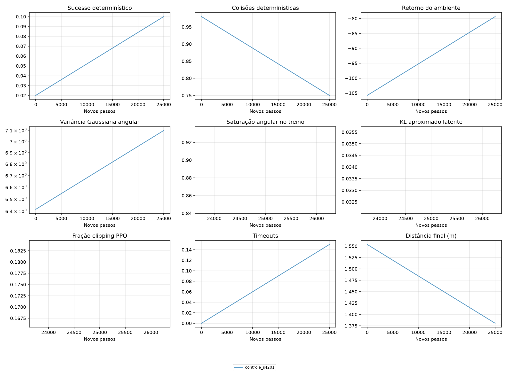
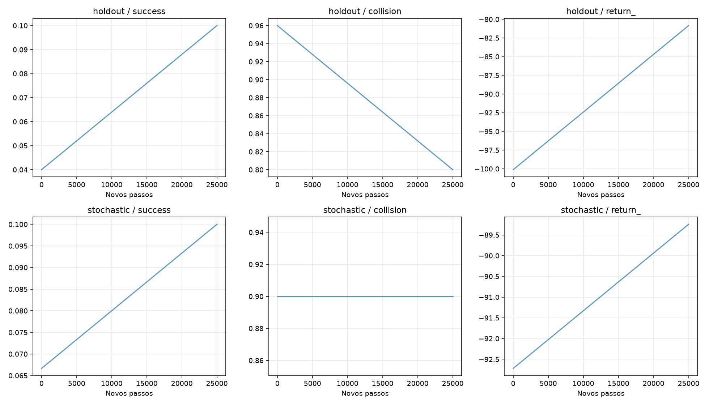

# Piloto PPO Robo-WORK

Estado: EM ANDAMENTO — resultados parciais.

Três braços × três sementes (4201–4203); teto de 250.000 novos passos por réplica, avaliações a cada 25.000. Orçamento máximo total: 2.250.000 passos. Réplicas interrompidas são censuradas; não extrapolar ao orçamento completo.

| Réplica | Novos passos avaliados | Sucesso fixo | Colisão fixa | Sucesso holdout | Estado |
|---|---:|---:|---:|---:|---|
| controle_s4201 | 25000 | 10.0% | 75.0% | 10.0% | em execução |

## Metodologia e limites

Checkpoint comum: origem.zip (125.000 no contador da linhagem), com pesos e Adam restaurados. Supervisor novo em estágio 0; gate original (100 episódios, sucesso ≥90%, zero colisões). Física, recompensa, sampler, mapas e observações são cópias congeladas. O desvio angular inicial é cerca de 2,533; este desenho mede recuperação a partir de um checkpoint histórico anterior à explosão, e não prova resgate direto da política de 6 milhões de passos. Retomada não replica a trajetória RNG da execução histórica; entre braços a semente é pareada.

A proposta original era fatorial 2×2 e 500 mil passos. Este piloto aplica a solicitação atual de três braços e 250 mil passos por réplica. Sem o quarto braço, não se pode estimar a interação entre entropia zero e limite angular.

SB3 amostra u~Normal, executa clip(u), armazena u e log p(u). O estimador PPO sobre u é consistente para E[R(clip(u))]; a KL e a entropia registradas são da distribuição latente, não da distribuição física recortada (que possui massas nos limites). Nunca substituir u pelo valor recortado no buffer usando a mesma densidade Gaussiana. A entropia latente é um incentivo inadequado quando a ação física já satura.

O terceiro braço usa Adam projetado: apenas log_std[2] é projetado em [-3,0], antes da primeira coleta e após CADA optimizer.step. Os momentos são preservados e registrados. Não há projeção entre uma coleta e a avaliação de sua old_log_prob. O deslocamento inicial de variância é parte explícita da intervenção, não uma atualização PPO nem mudança nos pesos de média/crítico. Não se usa tanh sem Jacobiano.

Os rollouts nominais têm 2×256 transições. Para atingir exatamente cada marco de 25.000 sem ultrapassar o orçamento, apenas o rollout que cruza o marco é encurtado para 2×212 passos. O minibatch final parcial é aceito por SB3. A mesma agenda vale em todos os braços; checkpoints e avaliações ocorrem após otimização.

100 sementes fixas do estágio 0 selecionam checkpoint e governam o gate; 100 sementes holdout do estágio 0 são somente diagnósticas, sem seleção automática; 30 sementes distintas medem execução estocástica. Ao atingir o orçamento completo, 300 sementes inéditas e 100 da arena completa são avaliadas. RNG de treino é restaurado após cada avaliação. Os mesmos cenários são reutilizados entre políticas; não tratá-los como episódios independentes entre avaliações.

Interromper somente a réplica experimental se houver parâmetros não finitos; std angular >10 em três avaliações consecutivas; KL latente >0,2 em três avaliações; ou, após pelo menos 75 mil passos, três avaliações com sucesso fixo zero, colisões ≥98% e saturação angular acumulada ≥98%. Desempenho baixo isolado não interrompe o controle. A interrupção antecipada limita comparação a marcos comuns.

Execução sequencial, afinidade de uma CPU, threads BLAS/Torch=1, nice=15. Pausa entre rollouts quando MemAvailable<3 GiB ou carga de 1 min≥6,5; interrompe se RSS do processo exceder 2 GiB. Recursos registrados em resources.jsonl. O namespace de processos não permite inspecionar PIDs do host; nenhuma ausência de processos locais é interpretada como ociosidade.

## Recomendação para o próximo ciclo

Aguardar o término das réplicas antes de escolher configuração. Os dados parciais não demonstram recuperação sustentada.

## Teste final inédito e arena completa

| Réplica | Conjunto | Sucesso | Colisão | Retorno |
|---|---|---:|---:|---:|

Preservação: 954 arquivos originais verificados; alterações detectadas: 0.

Diferenças pareadas e IC95% bootstrap por cenário, separados por semente de treino, estão em paired_statistics.json. São intervalos exploratórios condicionados às sementes treinadas, sem correção por comparações múltiplas; não estimam sozinhos a variabilidade entre treinos. Recompensa maior sem sucesso maior e colisões menores não qualifica uma configuração.
